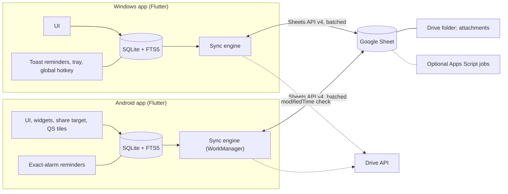

# Architecture

## Components
| Component | Responsibility |
| --- | --- |
| `core/db` | drift schema mirroring `sheet-schema.md`, plus local bookkeeping columns; FTS5 index on title/content. |
| `core/auth` | Google sign-in. Android: Google Sign-In. Windows: desktop OAuth loopback (`googleapis_auth`), refresh token in Windows Credential Manager. |
| `core/sheets` | Thin typed client over Sheets v4 + Drive v3: batchGet, batchUpdate, append, bootstrap. |
| `core/sync` | The algorithm in `sync-protocol.md`. Pure Dart, unit-tested with a fake Sheets backend. |
| `core/parse` | Quick-add parser: dates ("fri 3pm", "tomorrow", "every 2 weeks"), `#tag`, `^list`, `!priority`. English + French. |
| `core/recurrence` | RRULE expansion, next occurrence, repeat-from-completion. |
| `core/reminders` | Computes reminder instants and schedules platform notifications. |
| `features/*` | UI per feature. |

## Google Cloud setup (one-time, by the user)
- One Cloud project with Sheets API and Drive API enabled.
- OAuth consent screen: **Internal** if the account is Google Workspace, otherwise **External, In production**
  (avoids the 7-day refresh-token expiry of Testing mode). Only scope: `drive.file` (non-sensitive, no verification).
- OAuth clients: one **Desktop** client (Windows), one **Android** client (package name + signing SHA-1).

## Platform notes
- **Windows**: app keeps running in the tray so reminders fire; starts with Windows; global hotkey opens quick add.
- **Android**: `SCHEDULE_EXACT_ALARM`/`USE_EXACT_ALARM` + `POST_NOTIFICATIONS`; ask to ignore battery optimization;
  home-screen widgets via `home_widget`; share target and `PROCESS_TEXT` intent filter.
